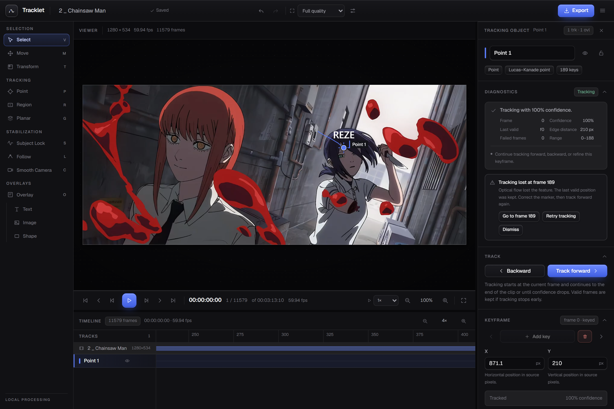

# Tracklet

<p align="center">
  <strong>Motion tracking, without the overhead.</strong>
  <br />
  Free. Lightweight. Made for creators.
</p>

<p align="center">
  Track objects, capture movement, and stabilize footage without opening a full video editing suite.
</p>

---

<p align="center">
  <em>Built independently. Free for everyone.</em>
</p>




## What is Tracklet?

Tracklet is a free, open-source motion tracking tool built to make tracking video as simple as possible.

I made it because I wanted to track objects in videos for montages and edits without having to open heavy editing software, deal with complicated workflows, or run into paid features and free trials just to get something tracked.

Sometimes you don't need an entire editing suite. You just need to track something.

Tracklet is designed around that idea. Import a video, select what you want to track, and let it do the work. It's lightweight, runs in your browser, and can be hosted locally on your own computer.

No subscription. No unnecessary complexity. Just tracking.

## Why Tracklet?

Most video editors offer motion tracking as part of a much larger suite of tools. That's great when you need them, but overkill when you only want to track an object or get its movement.

Tracklet focuses on making that process accessible.

- **Free, without restrictions from a trial** — No subscription or paywall.
- **Lightweight** — Focused on motion tracking instead of being a full video editing suite.
- **Simple to use** — Designed to make tracking accessible without a steep learning curve.
- **Runs locally** — Host it on your own computer and work through your browser.
- **Made for edits** — Useful for montages, motion graphics, overlays, and stabilization.

## Features

- Point-based motion tracking
- Video preview and timeline
- Tracking visualization
- Motion path generation
- Tracking data and keyframes
- Subject tracking
- Video stabilization
- Subject locking
- Project workflow
- Local video processing

> Feature availability may vary as development continues. Some features are still being improved.

## How to Use

1. Open Tracklet on your local machine.
2. Create a project.
3. Import your video.
4. Select the object or point you want to track.
5. Start tracking.
6. Review and refine the tracking result.
7. Use the resulting motion data in your workflow.

The goal is to spend less time setting things up and more time actually making your edit.

## Who Is Tracklet For?

Tracklet is built primarily for people who need motion tracking without the overhead of a full editing suite.

It's especially useful for:

- Video montages
- Velocity edits
- AMVs
- Motion graphics
- Object tracking
- Subject-following effects
- Camera stabilization
- Attaching elements to moving objects

Whether you're making a quick edit or experimenting with motion, Tracklet aims to make the process less tedious.

## Installation

Tracklet is designed to run locally.

### Requirements

- Node.js
- npm
- A modern Chromium-based browser or another supported browser

### Clone the repository

```bash
git clone https://github.com/YOUR_USERNAME/tracklet.git
cd tracklet
```

### Install dependencies

```bash
npm install
```

### Start the development server

```bash
npm run dev
```

Open the local address provided by Vite to start using Tracklet.

### Build for production

```bash
npm run build
```

### Preview the production build

```bash
npm run preview
```

## Privacy

Tracklet is designed to run locally on your own computer.

Your videos are not meant to be uploaded to a Tracklet cloud service. The application is intended to keep your workflow local rather than rely on cloud processing.

Refer to the application's implementation for the exact storage and processing behavior.

## Tech Stack

Tracklet is built using web technologies to keep it accessible and lightweight.

- TypeScript
- React
- Vite
- HTML5 video
- Canvas-based rendering
- Browser APIs

Additional libraries may be used for tracking, video processing, and rendering.

## Roadmap

Tracklet is still actively being developed. Some things I want to improve:

- [ ] Improve tracking accuracy and reliability.
- [ ] Better handling of occlusion.
- [ ] Better recovery when a tracked object leaves the frame.
- [ ] More tracking options and controls.
- [ ] Improve stabilization.
- [ ] Expand export options.
- [ ] Improve project saving and recovery.
- [ ] Optimize performance on lower-end hardware.
- [ ] Refine the interface and overall workflow.

This roadmap isn't fixed. It will evolve as the project grows and feedback comes in.

## Contributing

Tracklet is an independently developed open-source project. Contributions, feedback, bug reports, and feature ideas are welcome.

If you encounter a problem or have an idea:

1. Check whether an issue already exists.
2. Open an issue describing the problem or suggestion.
3. If you'd like to contribute code, submit a pull request.

I'm still improving Tracklet, so feedback is appreciated.

## License

This project is open source. See the `LICENSE` file for details.

---

<p align="center">
  <strong>Made independently. Built out of necessity. Free for everyone.</strong>
  <br />
  <br />
  Tracklet — Track anything. Make something with it.
</p>
